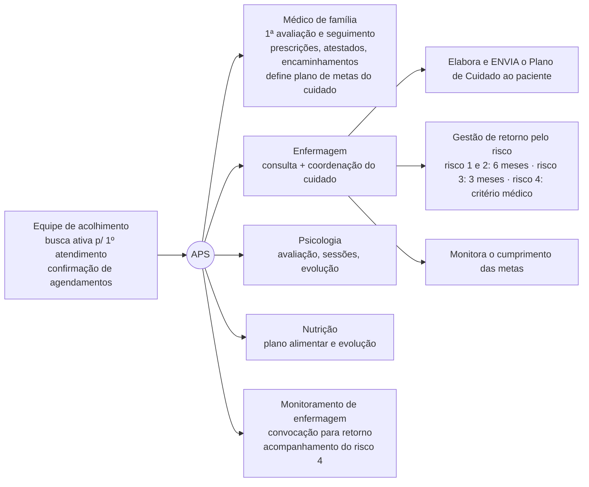

# Análise da pasta Desafio — o que muda no protótipo

Fontes: `Fluxo do processo.png`, `GESTÃO DO CUIDADO`, `PLANO DE CUIDADOS`, `GESTÃO DE RETORNO`, `GESTÃO DO CUIDADO - APS SESI dados fictícios.xlsx` e `Desafio Hackathon SESI Saúde 2026_rev 29 10 26.docx` (incluindo as imagens 6.1 Jornada e 6.2 Sistemas).

## 1. Fluxo do processo (mapa da APS)

Jornada que o SESI comunica ao trabalhador (imagem 6.1): **1** acolhimento com a enfermagem → **2** médica de família no mesmo dia → **3** classificação em 4 níveis de risco (define frequência e prazo de retorno) → **4** Plano de Cuidado Individual (nº de consultas/ano, prazo de retorno, cuidados, outros profissionais) → **5** acompanhamento contínuo com retornos programados.

**Onde o fluxo quebra (e onde o protótipo atua):** os três pontos em que a APS depende de o trabalhador responder — *confirmação de agendamento*, *envio/recebimento do plano* e *convocação para retorno*. É exatamente onde está o no-show de ~50%.

## 2. As fichas, campo a campo

### Gestão de Retorno (o trabalho de monitoramento da enfermeira)
- Data do monitoramento, médico de referência, classificação de risco, frequência de verificação de adesão, data da última consulta, atendimento com equipe multi.
- Retorno previsto, **status do plano de cuidado** (exemplo real: *"Não recebido"*), feito contato.
- **Desfecho do monitoramento:** agendamento realizado / mensagem enviada / aguardando retorno + observações + **data do próximo monitoramento**.
- O exemplo mostra o gargalo: *"aguardo resposta no WhatsApp"* — contato feito, sem agendamento, plano não recebido.

### Plano de Cuidados (o que o trabalhador recebe hoje)
- Documento técnico do SOC, 2 páginas, seções fixas: doenças crônicas, encaminhamentos (exemplo com **16 exames** listados por nome técnico), prevenção oncológica, atividade física, nutrição (IMC), psicologia, calendário vacinal, álcool/tabaco, outras recomendações, **próximo contato para monitoramento** e uma mensagem ao paciente com telefone.
- Problema: linguagem técnica e longa, sem "o que faço primeiro" — conversa com a barreira de **letramento em saúde** do desafio.

### Gestão do Cuidado (ficha clínica de coordenação)
- Tipo de atendimento (o exemplo é **Online**), classificação do serviço, linha de cuidado, risco + observações clínicas detalhadas, hábitos, condições, vacinação, saúde da mulher, rastreios.
- É dado clínico sensível: **fica no S+**. O protótipo não replica nada disso; só usa risco e datas.

### Planilha de dados fictícios (a ferramenta real de acompanhamento)
- 100 pessoas, 6 empresas, 4 médicos de referência. **40% com status INATIVO.**
- Só a identificação está preenchida. As colunas de acompanhamento estão vazias: última consulta médica/nutri/psico, **contato mês a mês (jul–dez/2026)**, previsão de retorno, risco atual e inicial, **data de envio do plano**, verificar adesão das metas, **status do plano de cuidado**, data da coordenação e da próxima.
- Leitura: o monitoramento hoje é planilha manual, coluna por mês. O painel da enfermeira substitui essa planilha.

## 3. Persona oficial (Marcos) — implicações diretas
- Turno 6h–14h, ônibus fretado de 1h10. A APS orienta usar o **turno oposto**, o que para ele significa ficar mais tempo na empresa e perder o fretado.
- Medo de que o chefe saiba; associa a APS ao "apto/inapto".
- Precisa de: autonomia, simplicidade extrema, ganho percebido no curto prazo e **privacidade total**.

→ Horários oferecidos precisam considerar o turno **e** o transporte; oferecer **atendimento online** (já existe na ficha) como alternativa.

## 4. Sistemas atuais (imagem 6.2)
S+ (registro e agendamento) · **WhatsApp** (lembretes, orientações, campanhas) · Chatbot (em implantação) · Painel de BI (indicadores do programa).
→ O protótipo não cria canal novo: usa o WhatsApp que já existe + uma página leve, e se pluga no S+ por adaptador.

## 5. O que isso virou no protótipo
1. Painel da APS com os campos da **Gestão de Retorno**: status do plano (não enviado / enviado / recebido), médico de referência, próximo monitoramento e registro de **desfecho** (feito contato, agendamento realizado, mensagem enviada, aguardando retorno, observações, próxima data).
2. Plano de cuidado do trabalhador como **tradução** do PDF: no máximo 3 próximos passos em linguagem simples, por seção do plano, com a lista técnica disponível só se ele quiser abrir. Abrir o plano marca "recebido".
3. Escolha de horário com opção **online**, microconsulta **no turno** e dica de transporte/turno.
4. Dados fictícios alinhados à planilha (empresas e médicos de referência do evento).

## 6. Atenção com a referência visual
A referência (`docs/referencias/referencia-visual.png`) traz uma "Visão da Liderança" e um dashboard com "Adesão ao plano 87%". O protótipo adota a identidade visual, mas não esse conteúdo: a visão da liderança que existe mostra só horários de liberação, sem motivo, e nenhum painel chama uso do canal de "adesão". As regras estão em `produto.md`.
