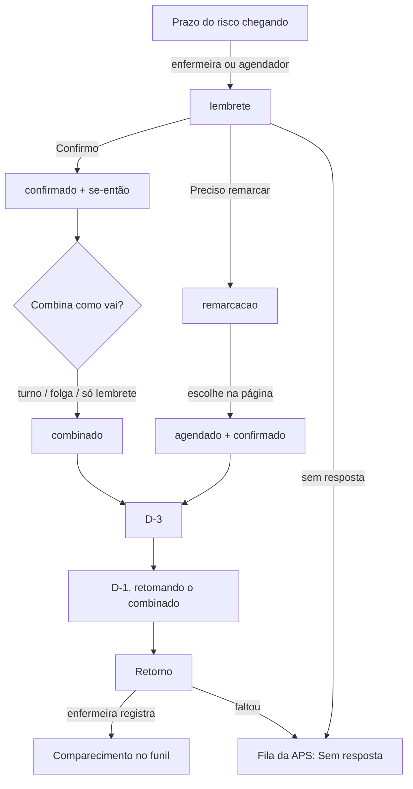
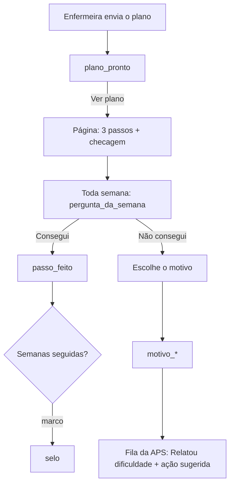

# Fluxo de mensagens no WhatsApp

Mapa de **toda mensagem que o Selo Saúde troca com o trabalhador**: o que sai, quando, com quais botões e o que cada toque faz no sistema. Serve para revisar os textos com a equipe de saúde e para plugar o WhatsApp real sem mexer nos módulos.

- Textos: `api/src/selo_saude/modulos/comunicacao/textos.py` (única fonte; este arquivo resume, não copia).
- Quem reage a quê: `api/src/selo_saude/composicao.py` e `modulos/comunicacao/manipuladores.py`.
- Porta do canal: `api/src/selo_saude/integracoes/whatsapp.py` (hoje simulada).

Legenda de estado: ✅ existe e funciona · 🟡 existe, mas disparado à mão · ⬜ falta.

## 1. Regras do canal

1. **Nenhum dado clínico na mensagem.** Nem diagnóstico, nem nome de exame, nem remédio, nem título do passo (pode ser sensível: vai só "o passo 2"). O detalhe fica na página pessoal, aberta pelo link.
2. **Fala a enfermeira de referência**, pelo nome. Nunca "o sistema".
3. **O ganho é o que a pessoa disse que importa** (família, energia, menos dor, sono).
4. **Sem medo, culpa, escassez falsa ou urgência artificial.**
5. **Um toque resolve.** Toda mensagem que pede algo traz o botão da resposta.
6. **Só o último botão vale.** Quando chega mensagem nova, os botões das anteriores deixam de valer (`do_sesi`).
7. **Abrir ou clicar não é adesão.** O toque vira evento de participação; adesão é o que a enfermagem verifica.

## 2. Catálogo

Dois tipos de mensagem, que no WhatsApp oficial têm regras diferentes:

- **Ativa**: o SESI abre a conversa. Fora da janela de 24h desde a última fala da pessoa, precisa ser **modelo aprovado pela Meta** (categoria utilidade), com o texto fixo e só as variáveis mudando.
- **Resposta**: vem logo depois de um toque da pessoa, dentro da janela de 24h. Pode ser texto livre.

Botões: **[R]** resposta rápida (no máximo 3 por mensagem) · **[L]** link para a página pessoal `/t/:token`.

### 2.1 Ativas (viram modelos)

| Id | Mensagem | Gatilho | Variáveis | Botões | Estado |
|---|---|---|---|---|---|
| `lembrete` | Retorno marcado: dia, hora, onde, ganho. "Você consegue ir?" | Enfermeira: **Enviar lembrete** | nome, enfermeira, dia, hora, local, ganho | [R] Confirmo · [R] Preciso remarcar · [L] Ver plano | 🟡 |
| `convite_agendar` | Sem consulta marcada: "Está na hora do seu retorno… vamos escolher um horário que caiba no seu turno?" | Mesmo botão, quando não há retorno em aberto | nome, enfermeira, ganho | [L] Escolher horário · [L] Ver plano | ✅ à mão ou pela cadência |
| `lembrete_d3` / `lembrete_d1` | "Na quarta / Amanhã, às 7h, é o seu retorno." Retoma o combinado ("sair do turno e ir direto") | 3 dias e 1 dia antes do retorno | nome, enfermeira, dia, hora, local, combinado | Se confirmada: [R] Preciso remarcar · [L] Ver plano. Se não: [R] Confirmo · [R] Preciso remarcar | ✅ pela cadência do dia |
| `plano_pronto` | "Seu plano de cuidado está pronto. São poucos passos… Só você e a equipe de saúde veem." | Enfermeira envia o plano (`PlanoEnviado`) | nome, enfermeira, ganho | [L] Ver plano | ✅ |
| `pergunta_da_semana` | "Esta semana você conseguiu fazer o passo 2?" | Enfermeira, no painel | nome, enfermeira, número do passo | [R] Consegui · [R] Não consegui · [L] Ver plano | ✅ à mão ou pela cadência |
| `como_voce_esta` | "Como você está desde o último atendimento?" | Data do próximo monitoramento, ou a enfermeira em **Perguntar como está** | nome, enfermeira | [R] Tudo bem · [R] Quero falar com a enfermeira | ✅ |
| `resultado_saiu` | "O resultado dos seus exames saiu. Veja na sua página pessoal… aqui não mostramos detalhes." | Resultado liberado (`ResultadoLiberado`) | nome, enfermeira | [L] Ver exames | ✅ |
| `link_pessoal` | "Você pediu no totem: por aqui você escolhe o horário com calma e em particular." | Pessoa pede no totem, com o crachá | nome, enfermeira | [L] Escolher horário · [L] Ver plano | ✅ |
| `selo` | "Você ganhou o selo X: N semanas seguidas cuidando de você." | `SeloConquistado` | nome do selo, semanas | mantém os botões da mensagem anterior | ✅ (ativa só se cair fora das 24h) |

### 2.2 Respostas (texto livre, dentro das 24h)

| Id | Mensagem | Depois de | Botões | Estado |
|---|---|---|---|---|
| `confirmado` | "Combinado! ✅ Horário garantido, sem fila. Eu te lembro 3 dias antes e 1 dia antes. Quer combinar como vai?" | Confirmo | [R] Saio do turno e vou direto · [R] Vou na folga · [R] Só me lembre (por vídeo: sem botões) | ✅ |
| `combinado` | "Fechado: quando sair do turno, você vai direto. Eu te lembro um dia antes." | Escolha do se-então | — | ✅ |
| `remarcacao` | "Sem problema! Escolha um horário que não bata com o seu turno." | Preciso remarcar | [L] Escolher horário | ✅ |
| `agendado` | "Pronto! Seu retorno ficou para…". No turno: "sua liderança recebe só o horário, nunca o motivo". Seguido de `confirmado` | Escolheu horário na página | — | ✅ |
| `motivo_*` | Uma resposta por motivo do "não consegui" (tempo, transporte, não entendi, remédio, dinheiro, outro) | Disse o motivo | [L] Escolher horário, para tempo e transporte | ✅ |
| `passo_feito` | "Boa! Cada passo conta." | Consegui | [L] Ver plano | ✅ |
| `checkin_ok` / `checkin_contato` | "Que bom!" · "A enfermeira vai entrar em contato em até 2 dias úteis." | Resposta ao `como_voce_esta` | — | ✅ |

## 3. Jornadas

### 3.1 Retorno: do lembrete ao comparecimento



### 3.2 Plano de cuidado e hábito



No WhatsApp real, "Não consegui" abre uma **lista** com os 6 motivos (o limite de 3 botões não comporta). Na página já é assim.

### 3.3 Exames

`resultado_saiu` → [L] Ver exames → página mostra o resultado explicado → `ResultadoVisto` (a enfermeira vê "visto", nunca o valor).

### 3.4 Totem

Crachá no totem → **Mandar o link para o meu WhatsApp** → `link_pessoal`. O totem nunca mostra o link.

## 4. Cadência (o agendador)

A regra está implementada em `mensagem_do_dia` (`modulos/monitoramento/regras.py`, testes em `api/tests/test_cadencia.py`) e roda por `POST /api/aps/cadencia`, que decide e envia. No painel da APS, o botão **Rodar as mensagens de hoje** chama essa rota e mostra quem recebeu o quê. No produto, uma tarefa periódica chama a mesma rota todo dia.

| Mensagem | Quando | Condição |
|---|---|---|
| Prioridade | Mensagem | Quando | Condição |
|---|---|---|---|
| 1 | `lembrete_d1` | 1 dia antes do retorno | retorno agendado ou confirmado; D-1 ainda não enviado |
| 2 | `lembrete_d3` | 2 a 3 dias antes do retorno | nem D-3 nem D-1 enviados |
| 3 | `convite_agendar` | faltam 30 dias ou menos para o prazo do risco | sem retorno marcado, sem pedido de remarcação e sem convite nos últimos 30 dias |
| 4 | `como_voce_esta` | chegou a data do próximo monitoramento | não enviado nos últimos 7 dias |
| 5 | `pergunta_da_semana` | toda semana | plano recebido, com passo pendente, não enviada nos últimos 7 dias |

Limites para não virar spam (e não gerar culpa), todos cobertos por teste:

- No máximo **1 mensagem ativa por dia** por pessoa, contando também as que a enfermeira mandou à mão. Vale a de maior prioridade.
- **A enfermagem primeiro**: com dificuldade aberta, pedido de contato ou falta no retorno, o agendador não manda nada. É a vez de uma pessoa falar com ela.
- **Sem cobrança em sequência**: o convite não se repete em 30 dias. Sem resposta, a pessoa entra na fila da APS como "Sem resposta" e a enfermeira decide.
- Cada lembrete automático sai uma vez só; o combinado vai no D-1.
- ⬜ **Fora do turno e fora da madrugada**: no produto, o envio espera o fim do turno da pessoa (o turno já está no cadastro). No botão da demo, sai na hora.

Como a API não guarda estado em memória e roda em várias instâncias, o agendador marca no banco o que já enviou (o `agenda` já registra D-3/D-1) e usa trava do Postgres para uma instância só disparar.

## 5. Ida e volta no sistema

### 5.1 Saída: fila de envio

Hoje `do_sesi` grava a mensagem e chama `whatsapp.enviar` **antes** de a transação ser efetivada. Se algo falhar depois, a mensagem já saiu e o banco volta atrás. Correção:

1. `do_sesi` grava a mensagem com `status = pendente` (na mesma transação do evento).
2. Depois do commit, um enviador lê as pendentes e chama a porta do WhatsApp.
3. A resposta da Meta atualiza `enviada` / `entregue` / `lida` / `falhou`. Esses estados alimentam o "contato realizado" do funil, **nunca** a adesão.

### 5.2 Entrada: webhook

Hoje o toque acontece na página web. No WhatsApp real, cada toque chega por uma rota nova (`POST /api/whatsapp/webhook`) que converte o botão na **mesma chamada que a página já faz**. Os módulos não mudam.

| Botão [R] | Mesma ação que a página faz em `/api/trabalhador/{token}` | Evento |
|---|---|---|
| Confirmo | `POST /consulta/confirmacao` | `ConsultaConfirmada` |
| Preciso remarcar | `POST /consulta/remarcacao` | `RemarcacaoPedida` |
| Saio do turno / Vou na folga / Só me lembre | `POST /consulta/compromisso` | `CompromissoEscolhido` |
| Consegui / Não consegui | `POST /plano/passos/{passo}/habito` | `HabitoRespondido` |
| Motivo da lista | `POST /plano/dificuldades` | `DificuldadeRelatada` |
| Tudo bem / Quero falar com a enfermeira | `POST /checkin` | `CheckinRespondido` |

O identificador do botão leva o id da mensagem de origem, para recusar toque em botão antigo (regra 6). Texto livre que a pessoa digitar vai para a fila da APS como "pediu contato"; o sistema não tenta interpretar.

### 5.3 Botões de link

[L] abre `/t/:token`. O token é o segredo do link pessoal, então ele só vai na mensagem para o número da própria pessoa, e a página não exige senha (o celular é o fator). No produto, vale expirar e renovar o token.

## 6. Consentimento

- **Opt-in** registrado na primeira consulta da APS ("Posso falar com você pelo WhatsApp sobre o seu cuidado?"), com data. Sem opt-in, nenhuma mensagem ativa.
- **Parar de receber** em qualquer mensagem ("SAIR"). A pessoa sai da cadência e entra na fila da APS para contato por outro meio.
- Base legal LGPD: tutela da saúde, pelo profissional de saúde, com o mínimo necessário. Por isso a regra 1.

## 7. O que falta, em ordem

| # | Item | Para a demo | Para o produto |
|---|---|---|---|
| 1 | ✅ Rota para enviar `como_voce_esta` | botão **Perguntar como está** na ficha da pessoa | entra na cadência |
| 2 | ✅ Regra da cadência e rota que roda o dia | botão **Rodar as mensagens de hoje** | ⬜ tarefa periódica com trava no Postgres e respeito ao turno |
| 3 | Fila de envio depois do commit | — | obrigatório |
| 4 | Webhook de entrada | — | obrigatório |
| 5 | Modelos submetidos à Meta | — | obrigatório (aprovação leva dias) |
| 6 | Opt-in e "SAIR" | campo no cadastro | obrigatório |
| 7 | Estados de entrega no funil | — | "contato realizado" passa a ser medido |

### Validação com envio real (Mega-API)

Para ver as mensagens num celular de verdade, a porta tem um segundo adaptador, `WhatsAppMegaApi`. Ele é ligado por variáveis no `api/.env`, que fica fora do git:

```
SELO_WHATSAPP=megaapi
SELO_MEGAAPI_URL=https://apistart01.megaapi.com.br
SELO_MEGAAPI_INSTANCIA=...
SELO_MEGAAPI_TOKEN=...
SELO_MEGAAPI_NUMERO_TESTE=55DDDNUMERO
SELO_MEGAAPI_APENAS=["20261001"]
SELO_URL_PUBLICA=http://IP-DO-NOTEBOOK:5173
```

- `SELO_MEGAAPI_APENAS` é opcional: só as matrículas da lista geram envio real.
- Os trabalhadores são fictícios. Toda mensagem vai para o número de teste, com uma linha dizendo para quem seria.
- O envio usa `POST /rest/sendMessage/{instancia}/text`.
- Botões. Os rótulos ficam em `comunicacao/textos.py` (`BOTAO_DE_RESPOSTA` e `BOTAO_DE_LINK`), com no máximo 20 caracteres cada.
  - **[R] resposta** vira `buttonMessage`, com no máximo 3 botões. O código da ação vai no `id` do botão, e é por ele que o webhook (item 4) vai saber o que a pessoa tocou.
  - Se a mensagem também tem um [L], o link vai no texto, porque o WhatsApp não mistura os dois tipos de botão. Sem [L], o texto leva "Ou responda pela sua página: link", para quem preferir responder por lá.
  - **Só [L]** vira `templateMessage`, com um botão que abre `SELO_URL_PUBLICA/t/token`.
  - Se a Mega-API recusar o botão, a mensagem sai como texto, com as opções escritas e o link.
  - Enquanto o webhook não existe, tocar num botão de resposta só manda o texto de volta pelo WhatsApp. O sistema não registra nada; a resposta registrada continua sendo a feita na página.
- Se a Mega-API falhar, a ação não cai: a mensagem já está gravada e aparece na página, e o erro vai para o log.
- A Mega-API não é a API oficial da Meta e serve só para validar. No produto, a porta aponta para a API oficial ou para o chatbot do SESI.

Na integração real, só a porta (`integracoes/whatsapp.py`) e a rota do webhook são novas. Textos, eventos e módulos continuam os mesmos: é isso que permite plugar o chatbot que o SESI já está implantando, em vez de criar canal novo.
